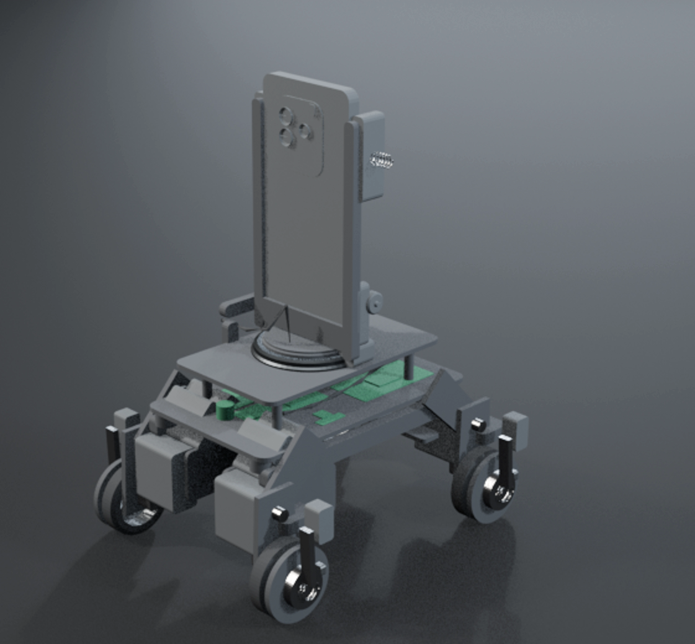

# WHEELBOT W1



> Prices are in US dollars for an English-speaking reader. The bill of materials is kept in
> the roubles the parts were actually bought for and converted once, at **90 RUB to the
dollar** — the rate is stated so the arithmetic can be checked, not hidden in a total.

A four-legged robot whose brain is the phone in its dock and whose feet are wheels. Each leg is
two 40 mm links — thigh at 45°, shin hanging from the knee — and each hub carries six slots with a
six-dog collar on the axle. A 0.6 N/mm spring pushes that collar home, so the wheel locks rigidly to
the leg and the machine stands on four wheels like a table; a 9 g servo pulls the collar 3 mm clear
and the same four wheels drive it at 0.503 m/s. Bend the knees and the legs step. The brake is
engaged with no power at all, so a flat battery, a lost Bluetooth link or a brown-out all leave the
robot standing instead of rolling away.

The interactive isometric figure these numbers are drawn from is in `figure/` (built by
`figures/phonebot/build.mjs`); its `parts.json` is the source of the OBJ/STL in `mechanical/`
and of the Blender stills in `renders/`.

## Where to start

| If you want to | Open |
|---|---|
| see the machine and take it apart | `figure/phonebot.html` — one file, no server, no network |
| understand the idea in five minutes | `docs/ARTICLE.md` |
| build one | `docs/ASSEMBLY.md`, then `docs/WIRING.md` |
| flash the controller | `firmware/` — PlatformIO, `pio run -t upload` |
| drive it from a phone | `app/index.html` — open it and press CONNECT, or `?demo=1` for the simulator |
| print it | `mechanical/wheelbot.stl` |
| check a number | `SPEC.md` and `figure/model.mjs` — everything else reads them |

## The numbers

Computed by `figures/phonebot/model.mjs` and the bill; nothing here is typed in by hand.

| Quantity | Value |
|---|---|
| Mass, no phone | 1.314 kg |
| Mass with a 200 g phone | **1.514 kg** |
| Top speed | **0.503 m/s** (4 × N20 at 200 rpm on a Ø48 wheel) |
| Runtime, driving while charging the phone | **2.6 h** |
| Runtime, driving with the phone on its own battery | 3.8 h |
| Runtime, walking | 1.8 h |
| Runtime, standing with the brakes locked | **19.4 h** |
| Contact box (wheelbase × track) | **177 × 144 mm** |
| Overall envelope (3D export) | 228 × 196 × 290 mm |
| Ride height (hip) | 82 … 96 mm over the pose library |
| Worst joint moment | 0.208 N·m (2.1 kg·cm) at full reach |
| Hip/knee servo margin | 4.4× static, 1.8× against a 2.5× dynamic allowance |
| Brake travel | 3 mm, 6 dogs, 12 mm mean radius |
| Brake dog shear at motor stall | 0.27 MPa against ~45 MPa PETG |
| Peak draw | 4.8 A at 6 V, 8 A buck |
| Pack | 2S 18650, 3500 mAh, 25.9 Wh |
| Cost, everything but the phone | **$121** — $40 electrical, $81 mechanical |

Prices are AliExpress, October 2026, and move daily; each row in the figure's cost panel links to
its own search.

## What it does

| Mode | State | Brake |
|---|---|---|
| STAND | Four wheels are feet, four MG996Rs level the body from the MPU6050 | engaged, no servo current |
| DRIVE | Four SG90s hold the collars clear, four N20s skid-steer | released, motors drive |
| STOW | Arms up 36°, body on four rubber feet, carried by the handle | engaged |

The phone is the master. It talks BLE GATT to the ESP32 — service
`6e400001-b5a3-f393-e0a9-e50e24dcca9e`, 12-byte command frames in, 20-byte telemetry out — from a
single HTML page using Web Bluetooth, so there is nothing to install and no account.

## Directory map

```
repo/
├── figure/       the interactive figure: phonebot.html (dark + light), its sources,
│                 parts.json — 164 parts with true bounds in millimetres
├── firmware/     PlatformIO, ESP32, Arduino framework: state machine, PCA9685 servo timing,
│                 TB6612 drive, brake switches over a PCF8574, MPU6050 levelling, BLE GATT
├── app/          the phone app: one HTML file, Web Bluetooth, runs with a simulator
├── mechanical/   OBJ + MTL + STL exported from parts.json (millimetres, Z up)
├── renders/      stills and the four clips: stand, drive, walk, turret
├── blender/      the render and animation scripts, and the two checks that keep the rig honest
├── docs/         ASSEMBLY.md, WIRING.md, USE.md, SPEC-CHANGE-two-link-leg.md, ARTICLE.md
├── eco/          the two shared modules the figure's sources import
├── SPEC.md       the design record every number is traced to
├── PUBLISH.md    how to push this to GitHub, with the metadata ready to paste
└── TWITTER.md    the launch posts
```

Start with `docs/ASSEMBLY.md`. It is written to be followed in order by someone who has not seen
the design record, and it ends with a twelve-point checklist to run before the phone ever goes in
the dock.

## Design in one page

- **Two links per leg.** A 40 mm thigh leaves the hip at 45°, a 40 mm shin hangs from the knee and
  the wheel sits at the ankle — 28 mm forward of the hip, 68 mm below it. Bending the knee lifts the
  foot 12 mm, and that is the whole gait. The shin is a fork: the wheel turns between its cheeks, the
  N20 is bolted to the inner one, the outer one carries the brake servo and the dog collar.
- **The phone sits on a pan turret.** A knurled base ring with an arc slot that stops the pan at
  ±70°, a ring gear, an SG90 and a pinion. The phone is held cameras forward in an open frame — two
  rails and a cross member, no back panel — so the lenses see the road, and the turret lets the same
  camera look ahead, aside or back.
- **The brake is the safety system.** Spring engaged, servo released, microswitch confirmed. The
  servos only ever work to open the brake, which is why the cheapest 9 g servo in the bill is
  enough (1.8 kg·cm) while the hip servos have to hold the stance (9.4 kg·cm at 6 V, a 2.35×
  margin on a 0.157 N·m worst arm moment with a 2.5× dynamic factor).
- **The phone is the only expensive part.** Everything else is a commodity board, servo or spring
  from a hobby-shop basket.

## What is not finished

- **The firmware drives four joints, not twelve.** It was written before the leg became two
  links; `docs/SPEC-CHANGE-two-link-leg.md` carries the exact patch (channel map, the 2-link IK,
  the three functions to replace). `pins.h` already has the twelve-channel map. It has never
  been compiled: there is no ESP32 toolchain on the machine it was written on.
- **The app tops out at ±127 mm/s.** The spec puts speed in one signed byte; the hardware does
  503. `SPEED_MAX_MMS` in `app/index.html` is the single place to change when the field widens.
  Everything else in the app was exercised in a real browser against the simulator: 27 protocol
  assertions, drag/hold/release, deadzone, 20 Hz cap, STOW confirm, STOP frame, link loss,
  ride-height trim, camera permission, 360-wide layout.
- **The figure's audit is not at zero.** Clearance, terminals, loose ends, folds and crowding are
  clean and `line ends: 0` in both themes, but 114 depth-order conflicts and 15 stand-in shapes
  remain, and 4088 pairs of nested coaxial parts (axle in hub, collar on boss) interpenetrate by
  design and are counted as sunk. The drawing reads at 1x; every junction has not been checked
  at 4x.
- **The animation clips are a first pass.** Geometry and motion are right (the wheels turn in
  their forks, the crawl lifts a foot 12 mm, one at a time), the lighting is flat and the phone's screen carries
  no interface in 3D.
- **`eco/chrome/sizes.js` still contains one unrendered Russian helper.** The figure itself is
  English end to end.
